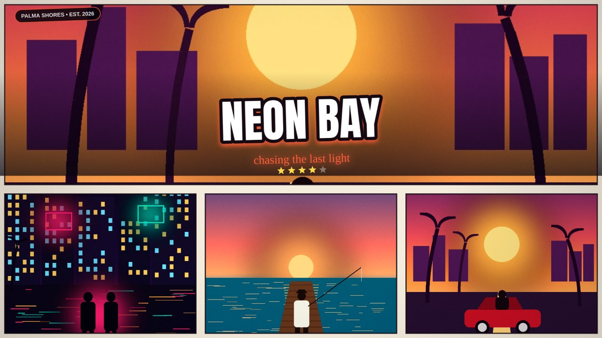

[](https://make.fun/c/gta6-cover-art-01)
[](https://make.fun/c/gta6-cover-art-01)
[](https://make.fun/c/gta6-cover-art-01)

# Neon Bay Cover Studio

Turn any photo and a caption into a multi-panel poster cover in the style of GTA 6's posters — offline, in your browser, exported as a PNG to share.



## What it does

- **Any photo**: add your own photos (or use the 3 built-in sample scenes), click a photo to put it in a panel, fill every panel at once.
- **Crop & position per panel**: click a panel to select it, drag the photo to move it, scroll to zoom, sliders for zoom and rotation.
- **6 poster layouts**: Vice Grid (hero + three), Nine Panel (3×3 with a title cell), Hero Bleed, Tilted Stack, Diagonal Split, Comic Strip.
- **5 colour grades**: Vice Sunset, Neon Night, Palm Gold, Teal Noir, Rose Heat — gradient-map washes over every panel.
- **Bold lettering**: Anton title with ink outline and neon glow, Pacifico script subtitle, a 5-star heat meter and a badge ribbon.
- **3 export sizes in one click**: 1080×1080, 1080×1350 and 1920×1080 PNG.
- **Fast**: photo → cover → PNG in a few clicks; undo/redo and a shuffle button for instant variants.

## Try it

```sh
node serve.ts
# open http://localhost:8080
```

No build step, no network: `app/` is plain static files. Every script, font and sample image is a file under `app/`; photos are read on your own machine and never uploaded.

## Originality

All art, city and character names are invented ("Neon Bay", "Palma Shores"). The lettering uses Anton and Pacifico, shipped under the SIL Open Font License (`app/fonts/OFL.txt`). No Rockstar Games logo, artwork, wordmark or font is used anywhere. The sample scenes are illustrations drawn for this app.

## Enter it

Built for the [Make GTA 6 Cover Art](https://make.fun/c/gta6-cover-art-01) bounty on make.fun. `main.ts` (Node 22) copies `app/` and `screenshots/` to `/output` and writes `dossier.json`:

```sh
mkdir -p out && MAKEFUN_OUTPUT_DIR=out node main.ts
```

## License

MIT — see [LICENSE](LICENSE).
